  

I'm a software developer who works across **machine learning**, **AI agents** and **full-stack TypeScript**, and I firmly believe in the power of teamwork and continuous growth.

## 🚀 What I do

- 🧠 **Machine learning & data science**: building end-to-end ML projects in Python and Jupyter, from data exploration to model evaluation, with TensorFlow and scikit-learn.
- 🤖 **AI agents & automation**: experimenting with LLM-powered agents, generative AI and workflow automation.
- ⚛️ **Web & mobile apps**: building with React, Next.js and Expo (React Native) in TypeScript.
- 🎓 **Teaching**: running beginner-friendly data science trainings (Python, Polars, Plotly and AI-assisted coding).
- ☕ **Always learning**: Java, C#/.NET, systems programming.

## 🛠️ Featured projects

| Project | What it is | Stack |
| --- | --- | --- |
| [expense-tracker](https://github.com/Glockrover/expense-tracker-starter) | Expense tracker app: fixed the income/expense calculations and refactored the UI into reusable components | React · JavaScript · Vite |
| [heart-disease](https://github.com/Glockrover/heart-disease) | Predicts heart disease from clinical data (UCI Cleveland dataset) | Python · scikit-learn · Jupyter |
| [time-desk](https://github.com/Glockrover/time-desk) | Time-management web app | Next.js · TypeScript |

## 🧰 Tech stack

### 💻 Languages

### 🎨 Frontend & mobile

### ⚙️ Backend, databases & DevOps

### 🧠 Machine learning & data science

### 🤖 AI & agents

### 🧪 Testing & tools

